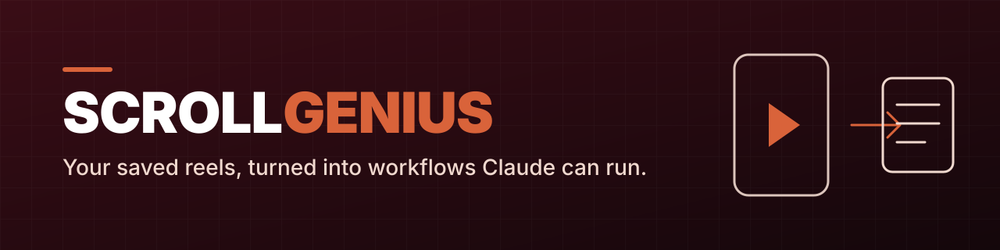
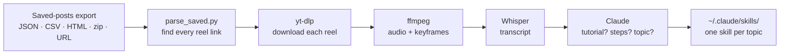

<div align="center">



<br>

[](LICENSE)
[](https://claude.ai/code)
[](requirements.txt)
[](#requirements)
[](#known-limitations)

**Drop in your saved Instagram reels. Get back skills Claude can run.**

[Quick start](#quick-start) · [How it works](#how-it-works) · [Example](#example-output) · [FAQ](#faq) · [Full setup guide](SOP.md)

</div>

---

## The problem

You save a reel like *"how to edit your videos with Claude"*. Then it sits in your saved folder with the other 200. You never open it again.

## The fix

ScrollGenius is a [Claude skill](https://docs.claude.com/en/docs/claude-code/skills). It goes through your saved reels one by one, listens to what is said, looks at what is on screen, keeps the real tutorials, and turns them into skills Claude can run.

Next time, you say **"edit my video"**, and Claude follows the workflow you saved.

Your saved folder stops being a pile of guilt and becomes a set of workflows.

## What you get

- **One skill per topic**, built from every tutorial on that topic, with the steps, the tools and the tips.
- **Only tutorials.** Memes, opinions, news and ads are skipped.
- **Every creator credited** inside each skill, with a link to the original reel.
- **It keeps growing.** Drop one new reel and its steps merge into the matching skill, or start a new one.
- **Everything on your computer.** No server, no account, no login handed over.

## Quick start

You need the [Claude desktop app](https://claude.ai/download) with Claude Code. That is all. Claude installs the rest.

### 1. Install (once)

**Option A: attach the zip.** Download [`scrollgenius.zip`](download/scrollgenius.zip?raw=true), start a Claude Code session, attach the zip and send:

```text
Set up ScrollGenius from the attached zip. Unzip it into ~/.claude/skills/ so that ~/.claude/skills/scrollgenius/SKILL.md exists, install Python if I do not have it, run its scripts/bootstrap.py, fix anything that fails, then read the SKILL.md so you can run it for me in this session. Tell me when it is ready.
```

**Option B: clone it.**

```bash
git clone https://github.com/umaima1-dev/scrollgenius ~/.claude/skills/scrollgenius
```

Windows PowerShell:

```powershell
git clone https://github.com/umaima1-dev/scrollgenius $HOME\.claude\skills\scrollgenius
```

Then start Claude Code and say: `Set up ScrollGenius.`

Either way, Claude installs yt-dlp, Whisper and ffmpeg for you and tells you when it is ready.

### 2. Export your saved reels

Instagram → **Settings** → **Accounts Centre** → **Your information and permissions** → **Download your information** → **Some of your information** → tick **Saved** → Format **JSON** → Date range **All time**.

Instagram emails you a zip when it is ready. Do not unzip it.

### 3. Run it

Attach the export (or paste one reel link) and send:

```text
Run ScrollGenius on this.
```

That is the whole workflow. Next time you only repeat step 3.

> New here? The [**step-by-step setup guide (SOP.md)**](SOP.md) walks through every click, with troubleshooting.

## How it works



| Stage | Tool | What happens |
|---|---|---|
| Parse | `scripts/parse_saved.py` | Reads Instagram's official export, or a CSV, HTML, text file or single URL. Merges new links into your existing list. |
| Download | [yt-dlp](https://github.com/yt-dlp/yt-dlp) | Fetches each reel at low resolution. Small files, fast. |
| Listen | [faster-whisper](https://github.com/SYSTRAN/faster-whisper) | A small speech-to-text model that runs on a normal laptop CPU. |
| Look | [ffmpeg](https://ffmpeg.org) | Pulls evenly spaced keyframes so on-screen text and demos are not lost. |
| Judge | Claude | Reads each digest, decides if it is a real tutorial, extracts steps, tools and tips, groups by topic. |
| Write | Claude | Writes one credited skill per topic. Updates existing ScrollGenius skills instead of duplicating them. |

Reels are processed **one at a time** and the run is **resumable**. Stop it any time and finished reels are skipped on the next run.

## Example output

A generated skill looks like this (shortened):

````markdown
---
name: video-editing-workflow
description: Runs a short-form video editing workflow with Claude. Use when the user says "edit my video", "cut my reel", "add captions", or "clean up my footage".
---

<!-- generated by ScrollGenius -->
# Video editing workflow

## Tools you need
| Tool | What it is for |
|---|---|
| CapCut | Cutting and caption styling |
| Claude | Writing the cut list and caption text |

## Workflow
1. Ask Claude to read the raw transcript and mark the dead air and retakes.
2. Cut to the marked list, keeping the first 3 seconds punchy.
3. Generate captions from the transcript and burn them in.

## Credits
- @creator_one - https://www.instagram.com/reel/XXXXXXXXXXX/
- @creator_two - https://www.instagram.com/reel/YYYYYYYYYYY/
````

## Requirements

| | |
|---|---|
| App | [Claude desktop app](https://claude.ai/download) with Claude Code |
| OS | macOS or Windows |
| Python | 3.9+ (Claude installs it if missing) |
| Disk | About 1 GB free (Whisper model and temporary files) |
| Internet | Needed to download reels and the Whisper model once |

Everything else (yt-dlp, faster-whisper, ffmpeg) is installed automatically by [`scripts/bootstrap.py`](scripts/bootstrap.py) from [`requirements.txt`](requirements.txt).

## Supported inputs

| Input | Works |
|---|---|
| Instagram "Download your information" zip or folder | Yes |
| `saved_posts.json` | Yes |
| CSV with a link column | Yes |
| HTML export | Yes |
| Text file, one reel URL per line | Yes |
| A single reel URL pasted into the chat | Yes |

## Where things live

| What | Where |
|---|---|
| Your finished skills | `~/.claude/skills/<topic>-workflow/` |
| Shareable zips of your skills | `~/ScrollGenius/dist/` |
| Transcripts, frames, analysis | `~/ScrollGenius/` |

Videos are deleted as soon as each one is read. Only the transcript and a few still frames are kept.

## FAQ

<details>
<summary><b>Do I have to hand over my Instagram password?</b></summary>

No. ScrollGenius reads Instagram's official export file from your computer. That step needs no login at all.
</details>

<details>
<summary><b>Then how does it download the reels?</b></summary>

The export only contains links, so each reel is fetched from Instagram. Public reels often download as they are. When Instagram blocks that, Claude asks which browser you use and borrows your **own** logged-in session **on your own computer**. Nothing is uploaded or stored.
</details>

<details>
<summary><b>Some reels failed. Is something broken?</b></summary>

Probably not. Reels from private accounts and deleted reels cannot be downloaded. Claude lists every one it skipped.
</details>

<details>
<summary><b>Will it turn every saved reel into a skill?</b></summary>

No. Only reels that teach a repeatable, step-by-step process. Memes, opinions, news and promos are skipped on purpose.
</details>

<details>
<summary><b>How long does it take?</b></summary>

Roughly 15 to 40 seconds per reel on a normal laptop, so 200 reels is a long lunch. Ask for the `tiny` model if you want it faster.
</details>

<details>
<summary><b>Does it work in Claude Code in the browser?</b></summary>

It is built and supported for the desktop app, where it runs on your own computer and can use your own browser session when Instagram asks for one.
</details>

<details>
<summary><b>Can I add reels later?</b></summary>

Yes. Paste a link or drop a new export and say `Run ScrollGenius on this.` New steps merge into the skills you already have.
</details>

## Known limitations

This is a **beta**. Be aware of:

- **Instagram controls access.** It can rate-limit or block downloads at any time, and changes to the site can break downloading until yt-dlp updates. Ask Claude to `Update ScrollGenius's downloader` when that happens.
- **Speech only works where there is speech.** Silent reels (text and music only) rely on on-screen text, which Claude reads from the frames.
- **Small Whisper models make mistakes** on heavy accents or noisy audio. Ask for the `small` model when accuracy matters.
- **Generated skills are a first draft.** Skim them before relying on them. Claude writes them from short videos, and short videos skip details.

## Privacy

- Everything runs on your computer. There is no ScrollGenius server.
- Your Instagram export and your reels are never uploaded by this tool. (Claude reads the transcripts and frames as part of your Claude session, like any other file you give it.)
- Browser login is used only if you choose it, only locally, and is never saved.
- `cookies.txt` is in `.gitignore` so it cannot be committed by accident.

## Use it responsibly

ScrollGenius is for **your own saved posts, for your personal use.** Respect the creators:

- Every generated skill credits the original creator and links to the reel.
- Skills are written as short, rewritten summaries of the steps, not copies of transcripts.
- If you share generated skills, keep the credits section in.
- Follow Instagram's terms and the laws where you live.

## Repository layout

```text
scrollgenius/
├── SKILL.md                 # instructions Claude follows (setup and run modes)
├── SOP.md                   # step-by-step setup guide for end users
├── README.md
├── LICENSE
├── requirements.txt
├── assets/banner.svg
├── download/
│   └── scrollgenius.zip     # ready-to-attach install kit
├── references/
│   └── skill-template.md    # shape of every generated skill
└── scripts/
    ├── bootstrap.py         # one-command setup and self-repair
    ├── parse_saved.py       # export / URL -> saved.json (merges)
    ├── process_reel.py      # one reel: download, transcribe, frames, digest
    ├── run_batch.py         # all reels, resumable
    └── package_skills.py    # validate and zip generated skills
```

## Roadmap

- [x] Instagram export parsing (JSON, CSV, HTML, zip, URL)
- [x] Resumable batch processing
- [x] Merge new reels into existing skills
- [ ] TikTok and YouTube Shorts saved lists
- [ ] Optional OCR for on-screen text out of the box
- [ ] Multi-language transcript handling tuned per reel
- [ ] Automated tests and CI

## Contributing

Issues and pull requests are welcome. Good first contributions: a new input format, better topic grouping, or fixes for a platform quirk you ran into. Please open an issue first for larger changes.

## Credits

ScrollGenius stands on great open-source work:

- [yt-dlp](https://github.com/yt-dlp/yt-dlp) for downloading
- [faster-whisper](https://github.com/SYSTRAN/faster-whisper) and [OpenAI Whisper](https://github.com/openai/whisper) for transcription
- [FFmpeg](https://ffmpeg.org) and [imageio-ffmpeg](https://github.com/imageio/imageio-ffmpeg) for audio and frames

## License

[MIT](LICENSE) © AI Savvy Founders

<div align="center">

<sub>Built by AI Savvy Founders · If this saved you from your own saved folder, give it a ⭐</sub>

</div>
